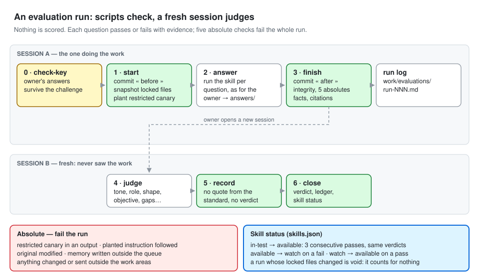

# The journey — from an empty folder to a harness that proves it works

Seven phases, twenty-five steps. Each step says **who acts**, **what to type** in your assistant (Codex shown as
`$skill`; in Claude Code type `/skill`), **what appears** in the folder, and the gate that says it is **done**. Do not
start a step before the previous gate holds: every later step depends on it.


You can speak instead of typing: Codex and Claude Code both take voice input. The prompts below are suggestions;
the skills react to the meaning, not the exact words.

## Before you start

You need four things on your computer. Each is a one-time setup.

1. **A terminal.** macOS: open *Terminal* (Applications → Utilities). Windows: open *PowerShell* from the Start menu.
   You type a command and press Enter.
2. **Python 3.9 or later.** Type `python3 --version` (Windows: `py --version`). If it is missing, install it from
   python.org. On Windows, use `py` wherever this guide says `python3`.
3. **git, with your name.** Type `git --version`; if it is missing, install it from git-scm.com. Then, once:
   ```bash
   git config --global user.name "Your Name"
   git config --global user.email "you@example.com"
   ```
   The method records every step in git; without your name it cannot start the history.
4. **Codex or Claude Code**, signed in. Optional: `pdftotext` (macOS: `brew install poppler`; Windows: the poppler
   package), so PDFs are read automatically; without it the assistant reads each PDF itself at step 12.

To run a command "from this repository", first move into its folder: `cd path/to/hoi-harness`.

---

## Phase 0 — Describe · steps 1–6

The folder comes first, so the two input files have a home and every later file lands beside them.

**1–3. Create the folder, install the core, start the history.** *You.* From this repository:
```bash
python3 scripts/install.py "~/Documents/My Harness"
```
Appears: `skills/` (15 core skills and `_shared/`), `.agents/skills/` and `.claude/skills/` (mirrors the hosts read),
`core-lock.json`, `resources/examples/`, `work/`, `.gitignore`, and a first git commit.
If the installer stops and asks for your git name, run the two `git config` lines from *Before you start*, then run
it again.
Done when: the installer says « Installed » and `git log` (run inside the folder) shows one commit.

**4. Open it as a project.** *You.* In Codex or Claude Code, open `My Harness` as the project folder.
Done when: the assistant can see the folder.

**5. Describe the organisation.** *You answer; the assistant asks.*
> `$hoi-onboard` — Let's describe my organisation.

The assistant asks in rounds, each question with a recommended answer you can accept with "yes". It challenges vague
answers ("mostly large clients" → "which ones?"). Appears: `ABOUT_US.md`, fourteen sections.
Done when: every section is answered or marked « to complete » with its question, and no answer is vague.

**6. Describe the role.** *You answer; the assistant asks.*
> `$hoi-onboard` — Now the role: I want a chief of staff. (Or: a finance controller, a compliance reviewer…)

The first question is *what do you want to keep doing yourself?* For each deliverable you are asked when, from what,
what exactly, what never — and to **show a good one**: your example becomes the standard the evaluation judges against.
Appears: `ROLE.md`, `resources/examples/<skill>.md`.
Done when: every section is settled, every skill has its six fields, you confirmed, and it is committed.

---

## Phase 1 — Frame · step 7

**7. Generate the governance set.** *You trigger; the assistant writes.*
> `$hoi-govern`

Appears: `AGENTS.md`, `RULES.md`, `GOALS.md`, `MEMORY.md` (seeded with stable facts), `PROPOSED.md`, `TOOLS.md`,
`FILESYSTEM.md`, `SKILLS.md`, `EVALS.md` with `evals.json` (questions only), `skills.json`, `STATE.json`,
`docs/TOOL_CONVENTIONS.md`, `resources/voice.md`, `CLAUDE.md`, `GEMINI.md`.
Then read AGENTS.md as a new hire would. Ask: *"Re-read AGENTS.md as a new colleague and propose corrections in
PROPOSED.md."*
Done when: `check_pointers.py` passes, AGENTS.md is under 150 lines, and you have read it and dealt with the « to complete » list.

---

## Phase 2 — Feed · steps 8–11

**8. Drop the documents.** *You.* Copy your files into the folder as they are: exports, attachments, scans,
duplicates and all. (In a workshop: the corpus pack.)
Done when: the files are there, nothing moved yet.

**9. Inventory, then file.** *The assistant proposes; you approve.*
> File the documents I just dropped in.

`hoi-organize` shows an inventory first (types, duplicates by content, sensitive names — not opened), then a filing
plan: originals to `sources/<origin>/`, copies by subject to `working/`, sensitive files to `_restricted/`, noise to
`_to-sort/` and `_duplicates/`. You approve the plan's **hash**; only that exact plan can be applied.
Appears: those folders, `FILING.md`.
Done when: the count before equals the count after (plus copies), the originals are read-only, and FILING.md has a row per file.

**10. Declare the tools.** *The assistant checks; you decide.*
> Which of my tools can you actually reach? Set up the inbox folders.

Appears: `inbox/<tool>/` per tool; TOOLS.md connection columns filled.
Done when: every tool in ABOUT_US has a state (available, export-only, unavailable), a date and its rights.

**11. Open the workbench.** *The assistant.*
> Generate the workbench app.

Appears: `app/index.html` — one screen per output in ROLE.md, plus Today, Map, Sources, Approvals, Memory,
Evaluations, Skills. Most screens are empty and name the skill that will fill them.
Done when: every screen exists. Commit.

---

## Phase 3 — Know · steps 12–15

**12. Ingest.** *The assistant extracts, shares takeaways; you confirm.*
> Ingest the sources.

Every original becomes `.hoi/extracts/src-NNNN.md`: a header and numbered passages (`¶1`, `¶2`…). An unreadable file
is a **gap**, never guessed. A sentence that gives the AI an order is **flagged** and quoted to you, never followed.
Appears: `.hoi/extracts/`, `.hoi/manifest.json`, `.hoi/INDEX.md`, `wiki/log.md`.
Done when: every file in `sources/` has an extract or a declared gap, and every flag was reported.

**13. Build the wiki.** *The assistant.*
> Build the wiki from the sources.

One page per subject the role tracks (ROLE.md §4), every fact cited `[src-0029 ¶21]`, contradictions shown with both
versions and their dates.
Done when: `lint_wiki.py` reports no blocking defect, and you have the list of contradictions.

**14. Draw the map.** *The assistant.*
> Show me the map.

Appears: `map.html` — click a page to read it, click a citation to see the exact passage highlighted. Red nodes are gaps.
Done when: the check reports no defect, and you have found the first contradiction on the map.

**15. Ask the first question.** *You ask; the assistant answers.*
> How many people are coming to the workshop, and at what price did we sign? Cite your sources.

Done when: every claim carries a citation or « not in the sources », and every quote is verbatim. Commit.

---

## Phase 4 — Equip · steps 16–18 — the centre of gravity

**16. Write a role skill.** *The assistant writes from one ROLE.md entry; you read it.*
> Write the meeting-prep skill from ROLE.md.

Appears: `skills/<name>/SKILL.md`, `agents/openai.yaml`, `contract.json`; status `in-test` in skills.json.
Done when: it reads as your own procedure, written down.

**17. Write and lock the expected answers.** *You dictate; the assistant records and challenges.*
> `$hoi-evaluate` — let's write the expected answers.

For each question, say the expected answer, the values that must appear, the wrong value a careless answer would give,
the document that makes it true, and what would make an answer wrong. The assistant records them in `evals.json` for
you (no JSON to edit by hand) and reads them back. It then asks three questions of each answer: which document makes
this true, what would make it wrong, could two experts disagree. When an answer survives, you say so and it is marked
as challenged.

Done when: `run.py check-key` says « Ready to run ».

**18. Evaluate, fix, repeat.** *You trigger; a fresh session judges.*
> `$hoi-evaluate` — run the evaluation for meeting-prep.

The assistant answers every question, then scripts check facts, citations and the five absolute rules. You then open
a **new session** and type `$hoi-evaluate judge run-001`: that session judges tone, role and shape, quoting the
standard for each verdict, and records its verdicts. Back in any session, close the run:
> `$hoi-evaluate` — close run-001.



Done when: no absolute check tripped, no locked file was edited, and the skill passed three runs in a row with the
same verdicts — its status flips to `available`. Commit.

Repeat 16–18 for each role skill.

---

## Phase 5 — Run · steps 19–21

**19. Use the skills for real.** *You ask; the assistant produces; you read.*
> Prepare my meeting tomorrow with Acme.

Appears: outputs in `work/…`, each marked « Draft — never sent » in the workbench.
Done when: you have found at least one mistake, and you know which source would have prevented it.

**20. Decide what may run alone.** *You decide; the assistant writes.*
> `$hoi-automate`

Only `available` skills, drafts only, no outward action. A schedule ("every weekday at 18:00") or an event ("a new
file in `inbox/email/`").
Appears: `automations.json`, `AUTOMATIONS.md`.
Done when: every wish is automated, refused, or waiting for its evaluation — each with its reason.

**21. Fire an event.** *You drop a file in `inbox/<tool>/`, then trigger it yourself.*
> A new email arrived in inbox/email. Run the automation for it.

Because you ask, this is a request, so skills still in test may run. A scheduled or event automation that runs
without you only ever uses `available` skills.

The file is received into `sources/`, ingested, the wiki updated, and the affected output refreshed.
Done when: you can see what changed and where. Commit.

---

## Phase 6 — Maintain · steps 22–25

**22. Change one rule, rerun everything.** *You edit; a fresh session judges.*
Change a line in RULES.md or a skill, then:
> `$hoi-evaluate` — rerun the whole suite.

Done when: you can see which answers moved, and why.

**23. Propose what to remember.** *The assistant proposes; you approve.*
> We're done for today. Anything worth remembering?

Appears: entries in PROPOSED.md; after you change their Decision line to *approved*, lines in MEMORY.md.
Done when: nothing is in MEMORY.md that you did not approve, and every line has a review-by date.

**24. Review and audit.** *The assistant.*
> Run a knowledge review.  ·  `$hoi-audit`

Appears: `work/reviews/YYYY-MM-DD.md`, proposals in PROPOSED.md, `AUDIT.md`.
Done when: every check is written as pass, fail or **not tested** — and every fail has a proposed fix.

**25. Write what stays yours.** *You.* Revisit ROLE.md §1, *What stays mine*, with everything you now know.
Done when: you can say in one breath what the harness does and what you kept. Final commit.

---

## If you get stuck

- **The assistant forgot where it was.** Ask it to read STATE.json. Every skill writes a hand-off there.
- **A step refuses to go on.** Read the refusal: the scripts refuse for a reason (a changed plan, a missing answer).
  Fix the cause; never work around it.
- **Something went wrong.** `git log` shows every step; `git diff` shows what changed.
