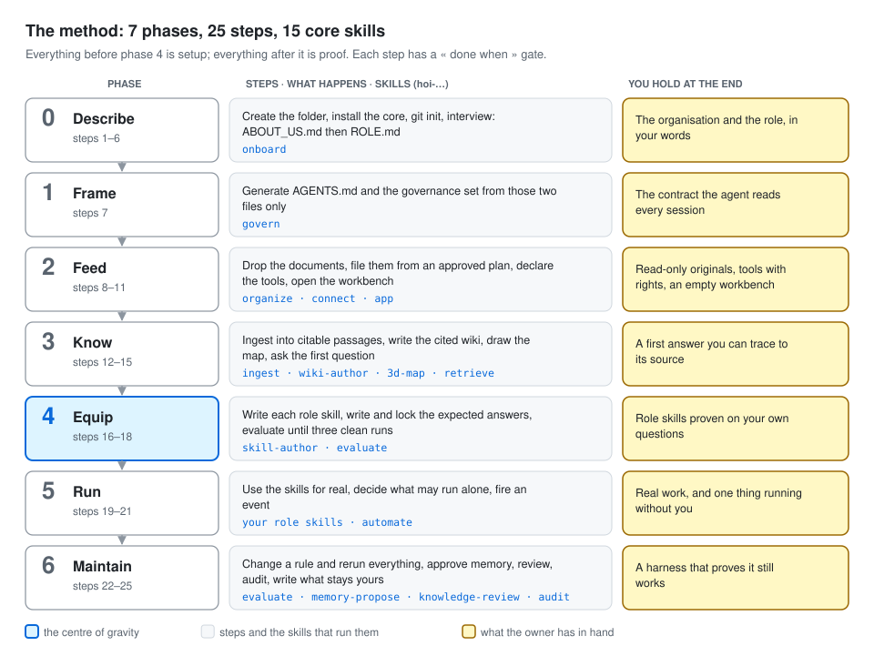
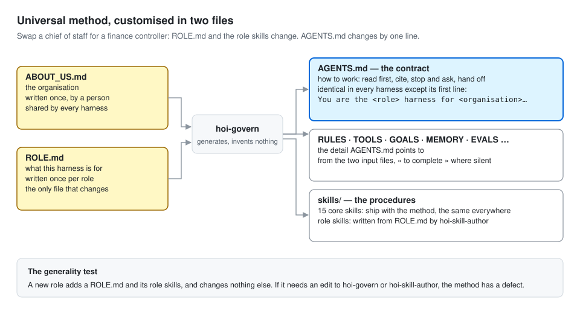

# HOI Harness

**A method for building an AI assistant for any role, inside an ordinary folder — and proving it works.**

A *harness* is everything around the model: who it works for, the rules it follows, the documents it may use, the
procedures it runs, what it may touch, and the tests that show it still behaves. This repository is the method and
the fifteen core skills that build one. You bring a folder, two descriptions written in your own words, and your
documents. You leave with an assistant whose every answer cites its source, whose every action you approved, and
whose behaviour you have tested on your own questions.

It works with Codex and Claude Code today, and with any host that reads the open
[Agent Skills](https://agentskills.io/) format. The model stays interchangeable: the harness is files.



## Start in five minutes

You need Python 3.9 or later, git, and Codex or Claude Code. Optional: `pdftotext` (part of *poppler*), so PDFs are
read automatically. New to the terminal? [JOURNEY.md § Before you start](JOURNEY.md#before-you-start) walks you through it.

```bash
git clone https://github.com/houseofichigo/hoi-harness.git    # or unzip the release you were given
cd hoi-harness
python3 scripts/install.py "~/Documents/My Harness"          # steps 1–3: folder, core skills, history
```

On Windows, type `py` instead of `python3`.

Open `My Harness` as a project in your assistant and type **`$hoi-onboard`** (Codex) or **`/hoi-onboard`**
(Claude Code). Answer the questions — by voice if you like. Then follow **[JOURNEY.md](JOURNEY.md)**, one step at a time.

## What to read

| If you want to… | Read |
| --- | --- |
| Understand what a harness is and why you would build one | [docs/what-is-a-harness.md](docs/what-is-a-harness.md) |
| Build one, step by step, with the exact words to type | [JOURNEY.md](JOURNEY.md) |
| Understand the method: principles, phases, evaluation, permissions, limits | [METHOD.md](METHOD.md) |
| Rebuild, extend or audit this repository: every decision, format and skill spec | [BRIEF.md](BRIEF.md) |
| Run it as a workshop | [docs/workshop.md](docs/workshop.md) |
| Use it with Codex, Claude Code or another host | [docs/hosts.md](docs/hosts.md) |
| Package a role with its proof, as an example repository | [recipes/README.md](recipes/README.md) |
| Know where each idea came from, and under which licence | [docs/provenance.md](docs/provenance.md) |
| Look up a word | [GLOSSARY.md](GLOSSARY.md) |

## How it is built



Two files are written by a person: **ABOUT_US.md** describes the organisation, once; **ROLE.md** describes one
harness — a chief of staff, a finance controller, a compliance reviewer. Everything else is generated from them.
AGENTS.md, the contract the assistant reads at the start of every session, is the same in every harness except its
first line. Change the role and only ROLE.md and the role skills change. That is what makes the method universal.

## The fifteen core skills

| Phase | Skill | What it does | Started by |
| --- | --- | --- | --- |
| 0 Describe | `hoi-onboard` | Interviews you to write ABOUT_US.md and ROLE.md | you |
| 1 Frame | `hoi-govern` | Generates AGENTS.md and the governance set from those two files only | you |
| 2 Feed | `hoi-organize` | Inventories, plans and files the folder — after you approve the plan's exact hash | the assistant |
| 2 Feed | `hoi-connect` | Checks which tools this session can really reach; keeps TOOLS.md true | the assistant |
| 2 Feed | `hoi-app` | Generates the read-only workbench, one screen per output | the assistant |
| 3 Know | `hoi-ingest` | Turns every document into citable, numbered passages; records gaps; flags planted instructions | the assistant |
| 3 Know | `hoi-wiki-author` | Writes one cited page per subject the role tracks; shows contradictions | the assistant |
| 3 Know | `hoi-3d-map` | Builds a clickable 3D map of the wiki and its sources | the assistant |
| 3 Know | `hoi-retrieve` | Answers with a citation per claim and verbatim quotes | the assistant |
| 4 Equip | `hoi-skill-author` | Writes each role skill from ROLE.md in the shared template | the assistant |
| 4 Equip | `hoi-evaluate` | Runs your questions against your locked answers; a fresh session judges; promotes or demotes skills | you |
| 5 Run | `hoi-automate` | Lets an evaluated skill run on a schedule or an event — drafts only | you |
| 6 Maintain | `hoi-memory-propose` | Proposes facts to remember; only your approval writes MEMORY.md | the assistant |
| 6 Maintain | `hoi-knowledge-review` | Finds stale, broken and recurring problems; fixes the wiki, proposes the rest | the assistant |
| 6 Maintain | `hoi-audit` | Read-only audit: pass, fail or *not tested*, per check | you |

The rules every skill follows, and how each is guaranteed — enforced, guarded or only requested — are in
[METHOD.md](METHOD.md#permissions). An optional plugin, [`hoi-harness-guard`](plugins/hoi-harness-guard/README.md),
blocks the common breaches of four of them in Claude Code before the tool call, rather than detecting them after it.

## Repository layout

```
hoi-harness/
├── README.md  BRIEF.md  METHOD.md  JOURNEY.md  GLOSSARY.md  CHANGELOG.md
├── skills/                    the 15 core skills, and _shared/ (references and helper scripts)
├── plugins/hoi-harness-guard/ optional Claude Code hooks
├── scripts/                   install.py · make_lock.py · validate_repo.py · test_scripts.py
├── tests/                     the throwaway fixture and the routing cases
├── docs/                      explanations and the five diagrams in docs/visuals/
├── recipes/                   how a role and its proof are packaged (examples live in their own repositories)
└── core-lock.json             version and content hash of every core skill
```

## Status — read this before relying on it

Version **1.1.0**. The scripts are tested end to end on a throwaway fixture (`python3 scripts/test_scripts.py`);
an independent review's defects were fixed before release. The fifteen skills are written and validated against the template, but each is **in test**: none has yet
completed the three clean evaluation runs against a reference recipe that the method itself requires before calling a
skill available. The first reference recipe, a chief of staff, is being built as its own repository. Codex hook support
for the guard plugin is not verified. See [BRIEF.md § Status](BRIEF.md#16-status-and-what-comes-next).

## Licence

MIT, © 2026 House of Ichigo. Patterns and short passages adapted from other open projects are credited in
[THIRD_PARTY_NOTICES.md](THIRD_PARTY_NOTICES.md). The vendored display libraries (3d-force-graph, marked) are MIT.
