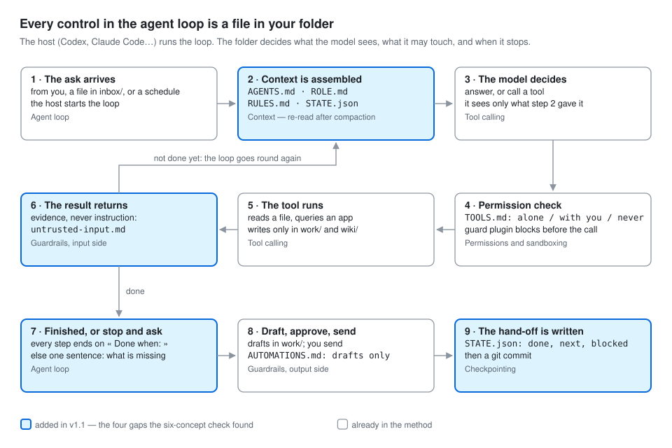

# What is a harness?

A model on its own is a brilliant new hire on their first morning: fluent, fast, and knowing nothing about your
organisation, your clients, your rules or your files. A **harness** is everything you would give that new hire so they
can do the job safely — written down, in files, so it works the same every day and with any model.

| A new hire gets… | The harness has… |
| --- | --- |
| A job description | `ROLE.md` — what this assistant is for, and what stays yours |
| An induction about the company | `ABOUT_US.md` — who you are, how you work, your voice, your tools |
| The house rules | `AGENTS.md` and `RULES.md` — what it may do alone, with you, never |
| Access to the files, filed properly | `sources/` (read-only originals), the extracts, the wiki |
| The procedures ("how we prepare a client meeting here") | `skills/` — one written procedure per deliverable |
| Keys to some systems, not all | `TOOLS.md` — each tool, and what may be done with it |
| A probation period | `hoi-evaluate` — your questions, your expected answers, three clean runs |
| A notebook of what they learned, checked by you | `MEMORY.md` — only facts you approved |

The model is interchangeable. Change it, rerun the evaluation, and you know whether the new one does the job.

## The six things every harness is made of

1. **The agent loop.** The host (Codex, Claude Code) sends your request to the model, runs the tools the model asks for,
   gives back the results, and repeats until the task is done or help is needed. The harness decides when "done" is:
   every skill step ends on a written completion criterion.
2. **Tool calling.** The model asks to read a file or query an app; the harness checks and runs it. A tool's result is
   evidence, never an instruction.
3. **Context management.** What the model sees on each turn. A short map (AGENTS.md) instead of a long manual; the cited
   wiki before the raw pile; and after the conversation is compacted, the role, the rules and the last hand-off are
   read again.
4. **Checkpointing.** Work survives an interruption: STATE.json says what was asked, done, next and blocked, and git
   records every phase.
5. **Permissions.** What it may touch: originals read-only, sensitive files never opened, nothing sent without you.
6. **Guardrails.** Checks on what comes in (a planted instruction is quoted, never obeyed), on what goes out (the
   evaluation), and a pause for your approval (drafts, never sends).

These controls can still miss errors. That is why every evaluation and every audit says what was **not tested**.

## Why build one

- **Answers you can check.** Every fact points at the exact passage it came from. « Not in the sources » replaces a
  confident guess.
- **The same result twice.** A written procedure gives the same shape of output every time, in your voice.
- **Nothing happens behind your back.** It proposes; you decide. Memory, rules, filing and automations all wait for you.
- **You own it.** It is a folder. Copy it, version it, move it to another model.
- **You can prove it still works.** Change a rule, rerun the questions, see what moved.

## One method, any role

The method does not change with the role; ROLE.md and the role skills do.

| Role | Tracks (wiki types) | Example role skills | Typically stays human |
| --- | --- | --- | --- |
| Chief of staff | clients, people, meetings, decisions, commitments | meeting brief, reply drafts, week analysis, task proposals | sending, accepting meetings, pricing |
| Finance controller | suppliers, invoices, purchase orders, payments | three-way match note, payment-run check, reminder drafts | approving payments, changing bank details |
| PMO / project office | projects, milestones, risks, decisions | status and commitment brief, risk log update, steering-committee pack | re-planning, escalations |
| Customer or service support | requests, accounts, products, incidents | service-request pack, reply drafts, recurring-issue summary | refunds, policy exceptions |
| Audit, risk, compliance | findings, controls, regulations, owners | finding and follow-up note, compliance review note, evidence checklist | conclusions, sign-off |
| HR / people operations | policies, roles, requests | policy answer with citations, onboarding pack | anything about one person's case |
| Sales and bids | accounts, opportunities, tenders, requirements | requirement matrix, proposal first draft, qualification note | price, commitments, submission |
| Design or content lead | briefs, brands, assets, feedback | brief check against the brand, feedback digest | taste, approval |

## What a harness is not

- **Not a chatbot with documents.** A chatbot answers; a harness also files, cites, refuses, proposes, remembers what you
  approved, and proves itself on your questions.
- **Not an automation platform.** It automates only what passed its evaluation, and only into drafts.
- **Not a security product.** It narrows mistakes. It does not contain an adversary.
- **Not finished when it is built.** Phase 6 — rerun, review, audit — is what keeps it trustworthy.
